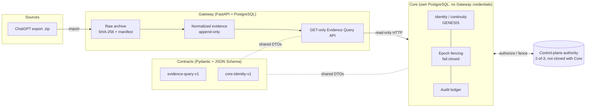

# Qingyu

**A self-hosted, append-only memory gateway for your AI conversations, plus a fail-closed governance core that decides who those memories belong to.**

[](LICENSE)


[中文说明](README_zh.md)

> [!WARNING]
> **Status: work in progress. Not production-ready.** Qingyu is an early, actively developed personal project. APIs, schemas and migrations may still change. Read the status section below before using it with real data.

## Status: work in progress

Based on the code and tests in this repository as of October 2026:

**Implemented and tested**

- **Gateway (Phase 3 frozen + Amendment #1).** Content-addressed raw archive (SHA-256 + manifest), ChatGPT export import (zip upload, staging, retry, cleanup worker), normalized conversation/message/attachment evidence, a GET-only Evidence Query API with its own read token and signed pagination cursors, and a GET-only export that packages a conversation or the full archive as a zip with a SHA-256 manifest. Export does not update or delete evidence. 16 Alembic migrations. The Gateway test suite (364 passed, 6 skipped) passes against a local PostgreSQL 16.
- **Contracts.** Pydantic DTOs and JSON Schemas for `evidence-query-v1` and `core-identity-v1`, with tests.
- **Core foundation pieces.** GENESIS service with an in-memory 2-of-3 test authority, continuity/epoch fencing checks, read-model and Gateway evidence clients, canonical JSON hashing, audit records. These have unit tests that run on plain Linux (see `ci/core-portable-tests.txt`).

**Partial / in acceptance**

- **Core R1 control plane** (signed operations, coordinator, durable PostgreSQL store, signer trust, activation lifecycle, "phase-b2" activation / signer admission / backup / migration readiness). Much of the code exists, but the acceptance process is not finished: the latest acceptance log in `core/docs/R1_ACCEPTANCE_LONG_RUN_STATE.md` records the minimal-trust design review as **BLOCKED**, and `core/docs/CURRENT_SCOPE.md` lists Phase B and Phase C as **not complete**.
- **Core test portability.** About two thirds of Core test files run on a plain Linux runner. The rest need Docker-managed PostgreSQL roles, Windows APIs (`winreg`, WSL paths) or owner-private configuration. See [`ci/core-portable-tests.txt`](ci/core-portable-tests.txt).

**Not started (explicitly deferred in the design docs)**

- Production GENESIS and formal activation
- Independent witness service (IBCS), multi-writer consensus, Byzantine defense
- Online key rotation, full suppression / cryptographic erase
- Memory Intelligence (derived memories), User / Relationship models, Runtime event ingest, model-provider integration

## What is it for?

Your history with AI assistants is scattered across vendor exports, apps and chat logs, and any "memory" a tool keeps for you can be silently rewritten, lost when you switch models, or duplicated when you restore a backup. Qingyu is an attempt to give one long-lived assistant identity a **trustworthy, self-hosted history**:

- **Archive your conversations once, keep them forever.** Import a ChatGPT data export; the raw bytes are stored content-addressed and the parsed conversations become append-only evidence.
- **Let other tools read, never rewrite.** Agents, runtimes or memory engines query history through a read-only API with its own token.
- **Keep identity separate from the model.** "Is this still the same assistant?" is answered by an identity record in Core, not by which model or app happens to be running.

Who might use it today: developers building personal AI assistants or agent runtimes who want an auditable memory layer they host themselves, and people interested in the design problems (append-only evidence, fencing, restore safety). It is **not** a ready-to-use end-user app.

## Design thinking

These points summarize `core/docs/architecture/QINGYU_CORE_PHASE1_DESIGN_REPORT.md`, `core/docs/CONTROL_PLANE_BOUNDARY.md`, `core/docs/CONTROL_PLANE_R1_SIMPLIFIED_TRUST_MODEL.md` and `gateway/docs/`.

- **Authority flows one way.** `Raw Archive → Normalized Evidence → Derived Memory → Context → Runtime → Model`. Anything lower in the chain can be deleted and rebuilt; it may never rewrite what is above it.
- **The Gateway is separate from Core.** The Gateway answers "what did the source record?" It is append-only and does not depend on Core, a runtime or a model. Core answers "who does this history belong to, and how is it understood?" Keeping them apart means a bug or compromise in the higher-level logic cannot corrupt the evidence.
- **Read-only evidence queries.** Core and other consumers use the Gateway's GET-only Evidence Query API. They reference evidence; they do not copy it into a new source of truth, and there are no cross-database foreign keys.
- **Core has its own database and no Gateway credentials.** Core never imports Gateway Python modules and never receives a Gateway database credential. Deleting Core must not invalidate Gateway history.
- **Fail-closed by default.** If the control-plane authority is unreachable, state does not match, or a proof is missing, Core refuses to write rather than guessing. The default authority backend is "unavailable", so a fresh install cannot write until it is explicitly configured.
- **Fencing with epochs.** Writes carry `(continuity_id, epoch, lease)`. A stale writer (for example a restored backup or a cloned database) is rejected with `EPOCH_STALE` / `LEASE_FENCED`, because the authority that issues epochs is not part of the cloneable Core backup.
- **2-of-3 authorization.** The authority interface requires a 2-of-3 witness quorum. The repository currently ships only an in-memory 2-of-3 implementation for deterministic tests; a production witness is deferred.
- **GENESIS needs separate authorization.** No migration creates an identity. Creating the one root identity (GENESIS) is an explicit, authorized operation mediated by the non-cloned control plane.
- **Auditability.** Changes are recorded as append-only audit entries and new assertions supersede old ones instead of overwriting them. Hashes use canonical JSON (RFC 8785) so evidence can be checked independently.

## Architecture



| Directory | What it is |
|---|---|
| [`gateway/`](gateway) | Memory Gateway: archive, ChatGPT import, evidence, read-only Evidence API |
| [`core/`](core) | Core: identity, continuity, governance, signer trust, audit, R1 control plane |
| [`contracts/`](contracts) | Shared DTOs and JSON Schemas between Gateway and Core |

## Quickstart (Gateway)

Requires Python 3.12 and PostgreSQL 16. These steps were checked on Linux against a local PostgreSQL 16; the `docker compose` step is provided for convenience.

```bash
git clone https://github.com/tangwenhai839-create/qingyu.git
cd qingyu/gateway
python3.12 -m venv .venv && . .venv/bin/activate
pip install -e ".[dev]"

cp .env.example .env
# In .env set POSTGRES_PASSWORD and matching DATABASE_URL, e.g.
#   POSTGRES_PASSWORD=<your-password>
#   DATABASE_URL=postgresql+psycopg://qingyu:<your-password>@127.0.0.1:5432/qingyu
#   If the password contains URL-special characters (@, :, /, %), percent-encode
#   them in DATABASE_URL so the connection string still parses.
# and three different random secrets for API_TOKEN, EVIDENCE_READ_API_TOKEN,
# EVIDENCE_CURSOR_SIGNING_KEY:
python -c "import secrets; print(secrets.token_urlsafe(32))"
# Also set ARCHIVE_ROOT to a writable directory.

# PostgreSQL 16 (reads POSTGRES_PASSWORD from .env):
docker compose up -d db

alembic upgrade head
uvicorn app.main:app --host 127.0.0.1 --port 8000

curl http://127.0.0.1:8000/health
curl -H "Authorization: Bearer $API_TOKEN" http://127.0.0.1:8000/api/v1/protected-ping
```

Imports also need `python -m app.importers.worker_runtime` from `gateway/`. Host binding, TLS at a reverse proxy, volumes, secrets, and backups are in [docs/DEPLOYMENT.md](docs/DEPLOYMENT.md).

Main endpoints: `POST /api/v1/import/chatgpt`, `GET /api/v1/import-jobs/{id}`, `POST /api/v1/archive/objects`, `GET /api/v1/evidence/...`, `GET /api/v1/export/conversations/{id}`, and `GET /api/v1/export/archive`. Open `http://127.0.0.1:8000/docs` for the OpenAPI UI. The export bundle format is described in [`gateway/docs/EXPORT_BUNDLE.md`](gateway/docs/EXPORT_BUNDLE.md).

### Running tests

```bash
# Gateway: needs a database literally named qingyu_test
cd gateway
export APP_ENV=test TEST_DATABASE_URL=postgresql+psycopg://qingyu:<pw>@127.0.0.1:5432/qingyu_test
DATABASE_URL=$TEST_DATABASE_URL alembic upgrade head
pytest -q

# Contracts
cd ../contracts && pip install -e ".[dev]" && pytest -q

# Core (portable subset)
cd ../core && pip install -e ".[dev]"
for f in $(sed 's#^core/##' ../ci/core-portable-tests.txt); do pytest -q "$f"; done
```

If the test database isn't migrated to the latest revision, Gateway tests stop early and tell you to run `DATABASE_URL=$TEST_DATABASE_URL APP_ENV=test alembic upgrade head`.

Core was developed mainly on Windows. Running its full suite needs the setup described in `core/README.md` and `core/docs/DB_SAFETY.md`.

## Roadmap

Consistent with the status above; nothing here is a promise of dates.

0. Enable GitHub Actions CI: a ready workflow is in [`ci/github-actions-ci.yml`](ci/github-actions-ci.yml) (lint, contracts, Gateway on PostgreSQL 16, portable Core subset); it only needs to be moved to `.github/workflows/`.
1. Make the full Core test suite runnable on Linux CI (Docker-based PostgreSQL fixtures, skip Windows-only tests cleanly).
2. Close the Core R1 acceptance blockers and finish phase-b2 (activation, signer admission, backup, migration readiness).
3. Production GENESIS and activation ceremony, with an independent witness.
4. More importers beyond ChatGPT exports.
5. Memory Intelligence: derived, rebuildable memories built on top of evidence.

## Contributing

Contributions are welcome, especially on documentation, tests and portability. Start with issues labelled [`good first issue`](https://github.com/tangwenhai839-create/qingyu/labels/good%20first%20issue) or [`help wanted`](https://github.com/tangwenhai839-create/qingyu/labels/help%20wanted), and read [CONTRIBUTING.md](CONTRIBUTING.md) and the [Code of Conduct](CODE_OF_CONDUCT.md). Questions and ideas go to [Discussions](https://github.com/tangwenhai839-create/qingyu/discussions). Report security issues privately as described in [SECURITY.md](SECURITY.md).

## History and AI-assisted development

This repository was assembled from the original per-component repositories, keeping their commit history (from September 2026) with original dates. Acceptance-evidence artifacts, database snapshots, backups and machine-specific paths were removed from history before publication, so some docs refer to evidence files that are not in this repository.

Much of the code was written with AI coding agents (e.g. OpenAI Codex) under the maintainer's direction and review. Commit identities from those agents were normalized to the maintainer account.

## License

Apache License 2.0. See [LICENSE](LICENSE).
